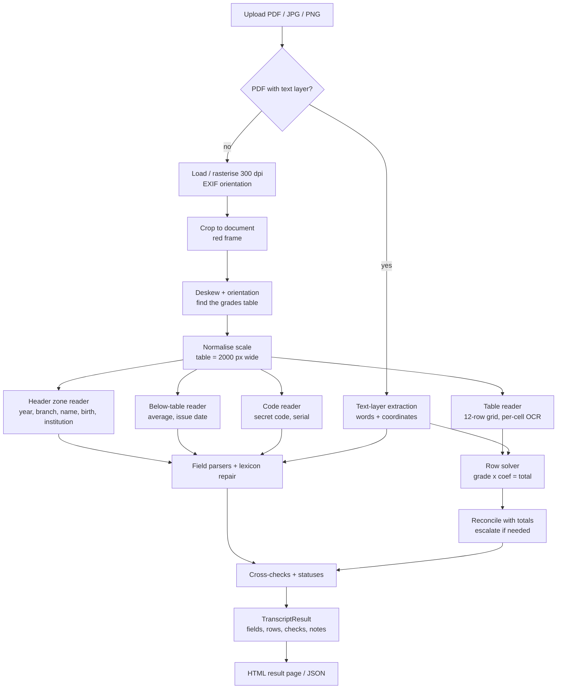

<!--
  INTERNSHIP REPORT - ESI
  Fill every [PLACEHOLDER]. Everything else is based on the project as built and measured.
  Deployment / Docker is intentionally NOT covered (to be added as a later chapter).
-->

<div align="center">

**République Algérienne Démocratique et Populaire**
**Ministère de l'Enseignement Supérieur et de la Recherche Scientifique**

# École nationale Supérieure d'Informatique (ESI)

---

# INTERNSHIP REPORT

## Automatic Extraction of Structured Data from Algerian Baccalaureate Score Transcripts
### (كشف نقاط البكالوريا) using OCR and Computer Vision

---

**Student:** [FULL NAME] — [YEAR / SPECIALTY, e.g. 2CS / SIW]
**Host organisation:** [COMPANY NAME — e.g. WasslaGO]
**Company supervisor:** [SUPERVISOR NAME, TITLE]
**ESI supervisor:** [ACADEMIC SUPERVISOR NAME]
**Internship period:** [START DATE] – [END DATE]
**Academic year:** [20XX / 20XX]

</div>

---

## Acknowledgements

[Write your own thanks: company supervisor, ESI supervisor, colleagues, family. Keep it short and personal.]

---

## Abstract

This report presents the design, implementation and evaluation of a web application that reads an
**Algerian baccalaureate score transcript** (*كشف نقاط البكالوريا*) from a scan, a phone photograph or a
PDF, and returns its content as structured data: registration number, session year, branch, full name,
birth date and place, institution name and code, the table of subjects with grade, coefficient and row
total, overall total, overall average, issue place and date, a secret code and a long serial code.

A naive "OCR the whole page then apply regular expressions" approach is unreliable on this document: the
text is Arabic, the background carries a dense diagonal watermark, a red seal and a blue signature overlap
the text, and real inputs are tilted photographs, screenshots and rotated pages. The solution is therefore
**layout-aware**. The grades table is detected geometrically, the page is oriented and deskewed relative to
it, every other field is located relative to the table, and each zone or table cell is cleaned and read
separately by Tesseract. The table is then treated as a **closed arithmetic system**
(`grade × coefficient = total`, the rows sum to the overall total, the coefficients sum to the printed
coefficient total, `total / coefficients = average`) which is used both to **choose between OCR candidates**
and to **repair or flag** errors.

On a real 10-page sample (scans, photographs, one screenshot, one page rotated by 90°, sessions 2017–2026,
five branches) all ten tables reconcile arithmetically, and the fields that could be verified by eye on seven
of those pages are correct in **93 %** of cases (94 of 101). On a synthetic benchmark with ground truth the
overall accuracy is 98.7 %. The system runs entirely locally (Flask, Tesseract, OpenCV), requires no cloud
service or database, and is covered by 32 automated tests.

**Keywords:** OCR, Tesseract, Arabic, document analysis, image preprocessing, table extraction, data
validation, Flask, Python.

---

## Table of contents

1. [General introduction](#1-general-introduction)
2. [Context and problem statement](#2-context-and-problem-statement)
3. [Study of the document](#3-study-of-the-document)
4. [Requirements and scope](#4-requirements-and-scope)
5. [Technology choices](#5-technology-choices)
6. [Overall architecture](#6-overall-architecture)
7. [Implementation](#7-implementation)
8. [Web application](#8-web-application)
9. [Validation, testing and evaluation](#9-validation-testing-and-evaluation)
10. [Problems encountered and how they were solved](#10-problems-encountered-and-how-they-were-solved)
11. [Limitations](#11-limitations)
12. [Future work](#12-future-work)
13. [Conclusion](#13-general-conclusion)
14. [References](#references)
15. [Appendices](#appendices)

---

# 1. General introduction

Administrative documents in Algeria — transcripts, certificates, attestations — are overwhelmingly handled
as paper or as images and PDFs of paper. Whenever an organisation needs the *data* in such a document
(for admission, scholarship, verification, statistics), someone retypes it. This is slow, error-prone and
does not scale.

The baccalaureate score transcript, issued each year by the *Office National des Examens et Concours*
(ONEC) / Ministry of National Education, is one of the most frequently requested documents. Its layout is
fixed, its content is partly redundant (the table obeys arithmetic relations) and its field values change
for every student. These properties make it a good candidate for **automatic extraction with built-in
verification**.

This internship, carried out at [HOST ORGANISATION], had one objective: build a **working minimum viable
product (MVP)** that takes one transcript (PDF, JPG, JPEG or PNG) and returns the extracted fields, the
grades as a real HTML table, a raw-OCR debug view and a JSON export, with a target accuracy of at least
90 % on clean, representative documents. The scope was deliberately limited to this single document type.

The report is organised as follows. Chapter 2 states the problem and the objectives. Chapter 3 analyses the
document. Chapters 4 to 6 define requirements, technologies and architecture. Chapter 7 details the
implementation module by module, Chapter 8 the web application. Chapter 9 describes validation and
measured results, Chapter 10 the main problems met during development, and Chapters 11–13 the limitations,
future work and conclusion.

> **Note on the use of AI assistance.** The software was developed with the help of an AI coding assistant
> (Claude Code). The student specified the objective, supplied the real sample documents, ran and tested the
> application, reported problems, and made the design and scope decisions. [Adapt or remove according to
> ESI's rules and to what you actually did; being transparent is recommended.]

---

# 2. Context and problem statement

## 2.1 Host organisation

[Describe the company in 1–2 paragraphs: name, activity, size, location, products. The project repository
is named *WasslaGO-BAC-OCR*, which suggests the context of the WasslaGO platform — confirm and describe
accurately.]

## 2.2 The problem

Given a photograph, scan or PDF of a BAC transcript, produce:

* the fixed set of fields listed in §4.1, with a **status and a confidence** for each;
* the subject/grade table as structured rows (and as a real HTML `<table>` in the interface);
* validation information telling the user **whether the extraction can be trusted**.

## 2.3 Why this is hard

| Difficulty | Consequence |
|---|---|
| **Arabic script**: cursive, context-dependent letter shapes, dots and diacritics distinguish letters | Tesseract's Arabic model confuses letters that differ only by dots (e.g. س/ص, ب/ت/ن/ي) |
| **Right-to-left text mixed with left-to-right digits** | Reading order of dates and numbers is non-trivial |
| **Dense diagonal watermark** ("الديوان الوطني للامتحانات والمسابقات") over the whole page | Naive thresholding turns the watermark into text-like noise |
| **Red seal, blue signature, ornamental frame** overlapping text | Extra ink inside the zones to read |
| **Heterogeneous inputs**: scans, phone photos, a phone *screenshot* with UI bars, a page rotated by 90° | Orientation, skew and document boundary must be recovered |
| **Case-sensitive random codes** (secret code, serial) | `x/X`, `0/O`, `1/l`, `2/z` are inherently ambiguous |
| **Variable content**: different branches have different subjects; optional subjects may be "not taken"; PE grades are not multiples of 0.25 | Fixed templates and simple validation rules break |

## 2.4 Objectives

1. A runnable local web application (Flask) with upload, result page, JSON export and debug view.
2. Local OCR pipeline for PDF and images, with preprocessing, Arabic/French handling and noise normalisation.
3. Table extraction returning structured rows, displayed as an HTML table and validated arithmetically.
4. Accuracy ≥ 90 % at field level on clean/representative documents, with an evaluation method.
5. No unnecessary external services, authentication or database.

---

# 3. Study of the document

The layout was derived from a **real 10-page sample** supplied by the host organisation (10 transcripts of
different students, years 2017–2026, different branches and capture conditions). Personal data from this
sample is **not** reproduced in this report or in the repository; all examples and test fixtures use
invented data.

## 3.1 Structure of the transcript

```
┌─────────────────────── ornamental red/green frame ───────────────────────┐
│  الجمهورية الجزائرية الديمقراطية الشعبية           وزارة التربية الوطنية    │
│  رقم التسجيل  (8 digits, left)                      كشف النقاط (red title) │
│                                       بكالوريا دورة : YYYY                 │
│                                       شعبة : <branch>                      │
│          بناء على محضر لجنة المداولات ... يشهد أن :                        │
│                                       السيد (ة) : <full name>              │
│                    المزداد (ة) في : <date> بـ <commune - wilaya>           │
│                    المؤسسة : <institution> / <institution code>            │
│                       قد نجح (ت) بعد حصوله (ها) على النقاط التالية :       │
│  ┌─────────┬─────────┬──────────┬─────────────────────────────┐           │
│  │ المجموع │ المعامل │ النقطة/20│            المادة           │ 4 columns │
│  ├─────────┼─────────┼──────────┼─────────────────────────────┤           │
│  │ 097.50  │    5    │  19.50   │ الرياضيات                   │ 12 body   │
│  │   --    │    2    │   --     │ اللغة الأمازيغية (not taken)│ rows      │
│  │   -     │         │          │ -   (unused placeholder)    │           │
│  ├─────────┴─────────┼──────────┴─────────────────────────────┤           │
│  │ 407.42  │   30    │                        المجموع العام   │           │
│  └─────────┴─────────┴────────────────────────────────────────┘           │
│  ┌───────┬───────────┐                                                     │
│  │ 13.58 │ المعدل العام /20                                                │
│  └───────┴───────────┘                                                     │
│  حرر بالجزائر في : 15 جويلية 2023            [QR code]                    │
│  red seal + blue signature                      الرقم السري : ES45aYFu     │
│                  1391500080636083/4FJPrzrXUSEPWD_BC---1374068124           │
└────────────────────────────────────────────────────────────────────────────┘
```

## 3.2 Observations that drove the design

1. **The table is a closed arithmetic system.** For each row `total = grade × coefficient`; the row totals
   sum to the *overall total*; the coefficients of the subjects actually taken sum to the *coefficient
   total*; `overall total / coefficient total` equals the *average* (rounded to two decimals). This
   redundancy is the single most valuable property of the document.
2. **The body always has 12 uniformly spaced row slots** in the sample. Unused slots print `-`.
3. **Optional subjects not taken** (typically Tamazight, *اللغة الأمازيغية*) print their coefficient but
   `--` for grade and total, and are not counted in the coefficient total.
4. **Physical education (التربية البدنية) is an average** of several tests; its grade is *not* a
   multiple of 0.25 (observed: 17.67, 19.42, 19.13). Any rule "grades are multiples of 0.25" is wrong.
5. **The subject list and its order depend on the branch** (experimental sciences, mathematics, letters and
   philosophy, foreign languages, technical mathematics with a specialty, management and economics…).
6. **Formats changed over the years**: dates are `yyyy-mm-dd` or `dd-mm-yyyy` depending on the
   document (right-to-left rendering reverses digit groups), the issue date may be `17 جويلية 2025` or
   `2019/07/16`, institution codes have 4 to 8 digits, and the serial code prefix is 16 digits on recent
   documents but alphanumeric on old ones.
7. **A passing student's total lies between roughly 9.5× and 20× the coefficient total** (the document is
   issued to graduates, average ≥ 10, with a rounding rule that can print 10.00 for 9.99).
8. **Capture conditions vary widely** — see §2.3.

## 3.3 Required fields

| Key | Arabic label | Description |
|---|---|---|
| `registration_number` | رقم التسجيل | 8-digit registration number |
| `session_year` | بكالوريا دورة | session year |
| `branch` | شعبة | stream |
| `full_name` | السيد (ة) | full name |
| `birth_date`, `birth_place` | المزداد (ة) في / بـ | birth date and place |
| `institution_name`, `institution_code` | المؤسسة | institution and its code |
| `grades[]` | المادة / النقطة / المعامل / المجموع | subject, grade, coefficient, row total |
| `overall_total`, `coefficient_total` | المجموع العام | totals row |
| `overall_average` | المعدل العام | average /20 |
| `issue_place`, `issue_date` | حرر بالجزائر في | issue place and date |
| `secret_code` | الرقم السري | secret code |
| `serial_code` | long code containing `USEPWD_BC` | bottom serial |

---

# 4. Requirements and scope

## 4.1 Functional requirements

* **F1** Upload one file: PDF, JPG, JPEG or PNG.
* **F2** Extract all fields of §3.3, each with *value*, *status*, *confidence*, *raw OCR text*, *note*.
* **F3** Extract the grades table as structured rows and display it as an **HTML table**.
* **F4** Display **missing fields** clearly.
* **F5** Provide a **JSON export** (download) and a **debug view** (raw OCR per zone, crops, normalised page).
* **F6** If a PDF has a text layer, use it instead of OCR.
* **F7** Process multi-page PDFs (one transcript per page).
* **F8** Provide a way to **measure accuracy** against ground truth.

## 4.2 Non-functional requirements

* **N1** Local-only: no cloud service, no database, no authentication in the MVP.
* **N2** Python 3.10+; installable from a `requirements.txt` in a virtual environment.
* **N3** Accuracy ≥ 90 % on clean/representative documents.
* **N4** Robustness: a failure on one page must not lose the others; every failure must be reported to the user.
* **N5** Maintainability: rules and vocabularies in data files, modules with a single responsibility, automated tests.
* **N6** Privacy: no personal data of real people in the repository (synthetic fixtures only).

## 4.3 Out of scope

Any other document type; user accounts; a database; model training; and (for this report) deployment.

---

# 5. Technology choices

| Need | Choice | Why |
|---|---|---|
| Language | **Python 3.11** | Rich image/OCR ecosystem; required by the brief (3.10+). |
| Web | **Flask** | Lightweight, enough for upload / background job / result pages. |
| OCR engine | **Tesseract 5** (LSTM, `ara` + `eng`, optional `fra`) through **pytesseract** | Local, free, supports Arabic; configurable per call (language, page-segmentation mode, whitelist). |
| Image processing | **OpenCV** (headless) + **NumPy** + **Pillow** | Morphology, connected components, Hough transform, warping. |
| PDF | **PyMuPDF** | Reads text layers *with word coordinates*, rasterises pages without Poppler. |
| Fuzzy matching | **RapidFuzz** | Fast Levenshtein-based ratios for vocabulary matching. |
| Tests | **pytest** | Unit and integration tests. |
| Fixtures | **Pillow + arabic-reshaper + python-bidi** | Draw synthetic Arabic transcripts with known ground truth. |

**Why not a cloud OCR or a deep-learning layout model?** The brief asked for local, dependency-light,
service-free operation. Moreover the document's strong arithmetic redundancy lets a classical pipeline
reach high *table* accuracy without training data, which did not exist (only 10 samples).

**Why Tesseract's Arabic model is only part of the answer.** Tesseract is weak on Arabic names and on
short Arabic words; the design therefore minimises the amount of free Arabic text that must be trusted
(subjects come from a closed vocabulary; places from a wilaya list) and maximises the use of digits,
which are read much more reliably by a digits-only configuration.

---

# 6. Overall architecture

## 6.1 Principle

> *Find the table first. Locate everything else relative to the table. Read small clean crops, many times,
> with the engine best suited to the content. Use the arithmetic of the document to decide between
> readings and to know when to distrust them.*

## 6.2 Pipeline



## 6.3 Modules

| Layer | File | Responsibility |
|---|---|---|
| Web | `app.py`, `templates/`, `static/` | Upload, background job, polling, result page, JSON download |
| Config | `config.py` | All settings through environment variables / `.env` |
| Orchestration | `services/pipeline.py`, `services/table_service.py` | File → results; table extraction with escalation |
| Data model | `services/models.py` | `Field`, `GradeRow`, `Check`, `TranscriptResult` |
| Loading | `ocr/loader.py` | PDF/image loading, text-layer detection |
| Image | `ocr/preprocessing.py` | Ink map, binarisation, deskew, crop helpers |
| Geometry | `ocr/layout.py` | Table detection, orientation, column geometry |
| OCR | `ocr/ocr_service.py` | Tesseract wrapper and recipes |
| Zones | `ocr/zone_reader.py` | Header lines, registration number, average, issue line, codes |
| Table | `ocr/table_reader.py` | Row grid, cell cleaning, candidates |
| Parsing | `parsers/bac_parser.py` | Field parsers, voting, cross-checks |
| Table logic | `parsers/table_parser.py` | Row solver, reconciliation, subject naming |
| Vocabulary | `parsers/subjects.py`, `parsers/lexicon.py`, `data/*.json` | Fuzzy matching and spelling repair |
| Text | `parsers/normalize.py` | Arabic normalisation, number repair |
| Digital PDFs | `parsers/text_layer.py` | Extraction without OCR |
| Tooling | `scripts/make_fixtures.py`, `scripts/evaluate.py`, `tests/` | Fixtures, accuracy measurement, tests |

## 6.4 Design decisions

* **One responsibility per module**, dependencies pointing downwards (web → services → parsers/ocr).
* **Rules are data.** Subjects, aliases, branch row orders, wilayas and institution words are JSON files that a
  non-programmer can extend.
* **Everything is a candidate until reconciled.** OCR modules return *lists of candidate strings*; parsers
  decide. This keeps OCR noise out of the business logic and makes voting possible.
* **Never crash on one page.** Each page is processed inside a guard; failures become an `error` on that page.
* **No silent guessing.** A repaired value is marked `derived`; an unverifiable one `low_confidence`.

---

# 7. Implementation

## 7.1 Input loading (`ocr/loader.py`)

* **Images**: opened with Pillow, EXIF orientation applied (phones store rotation as metadata), alpha
  channels flattened onto white, low-resolution images (long side < 1800 px) upscaled to 2200 px, huge
  images capped at 5200 px.
* **PDFs** (PyMuPDF): for every page the text layer is read. If it contains more than 80 characters *and*
  looks like a transcript (at least three of the words كشف / النقاط / بكالوريا / المجموع / المعدل, or the
  string `USEPWD`), the page takes the **text-layer path**. Otherwise it is **rasterised at 300 dpi**
  (pixel count capped for memory safety). The sample PDF consisted of ten scanned pages with no text layer.
* At most `MAX_PAGES` (default 10) pages are processed; password-protected PDFs are rejected with a clear error.

## 7.2 Ink map and binarisation (`ocr/preprocessing.py`)

### 7.2.1 The `max(B,G,R)` ink channel

Printed text is black; the seal is red, the signature blue, the paper yellow, the frame red/green.
Converting to grayscale by luminance leaves the seal and signature dark. Taking the **maximum colour
channel** instead makes anything with a strong colour component *bright*, while black stays dark:

```python
def ink_gray(img):            # H x W x 3  ->  H x W
    return img.max(axis=2)
```

This single line removes the seal, signature, title and frame from the ink image and was one of the
highest-value decisions of the project.

### 7.2.2 Background normalisation and threshold

The pale watermark and uneven lighting are removed by dividing the image by an estimate of its local
background (grayscale dilation + median blur with a kernel proportional to image size):

`norm = 255 · gray / background`

A pixel is ink if `norm` is below a threshold. By default the threshold is **Otsu's** [2], clamped to
[0.50, 0.86]·255. Stricter variants (0.50, 0.42, 0.36) are tried automatically for zones that cannot be
segmented (heavily watermarked scans).

### 7.2.3 Deskew

Long straight lines (table borders, page frame) are found with a probabilistic **Hough transform** [5] on a
downscaled binary image. Angles are folded modulo 90° so horizontal and vertical lines agree, and the
**length-weighted median** is taken. The image is rotated by this angle with an enlarged canvas so nothing
is cropped.

### 7.2.4 Document cropping

Phone screenshots contain UI bars and black margins. The transcript is located through its **red/pink
ornamental frame**: an HSV mask (hue red, saturation > 45, value > 90) is closed morphologically, the
largest connected component's bounding box (plus a margin) is kept. If the component is implausibly small
the full image is used.

### 7.2.5 Crop preparation for OCR

`prepare_for_ocr` upscales a crop so text is about `target_height` pixels tall (cubic interpolation),
normalises contrast, optionally Otsu-binarises, and adds a white margin; Tesseract is noticeably more
accurate on text of 60–120 px height with a margin.

## 7.3 Page geometry (`ocr/layout.py`)

### 7.3.1 Finding the table

1. Extract long horizontal and vertical rules with morphological opening (kernels proportional to the
   page).
2. Keep horizontal rules that are long (> 45 % of the width) and thin.
3. **Group rules that share the same left/right extents** (tolerance 3 %, then 7 % for faded or warped
   scans). The table has four such rules (top, under the header, above the totals row, bottom) close
   together; the ornamental page frame produces only two, far apart. The group with the most rules whose
   vertical span is plausible (10–60 % of their length) is the table.
4. Vertical rules inside the body give the four column borders. If they cannot be found the default
   proportions `[0, 0.173, 0.343, 0.485, 1.0]` of the table width are used and a note is recorded.

The result is a `TableGeometry` (`x0`, `x1`, rule positions, `header_bottom`, `total_top`, column
positions).

### 7.3.2 Orientation

The table is wider than tall (about 2.3:1). If detection only succeeds after a 90° rotation, the page was
sideways. To tell 0° from 180° (or 90° from 270°) the code looks for the **small boxed average** that exists
only under the table's bottom-left corner. If it is absent, the page is rotated by 180° and the test
repeated.

### 7.3.3 Scale normalisation and retries

The final image is resized so that the **table is exactly 2000 px wide**. All later thresholds (row pitch,
band heights, kernel sizes) are expressed relative to that width, which makes the pipeline independent of
the input resolution. Because faded rules sit at the detector's threshold, detection is retried at working
sizes 1600, 1300, 2000 and 1000 px. Before this retry loop the same page could be found or missed depending
only on the PDF render DPI (150–300 dpi); afterwards all 10 pages are detected at every tested DPI.

## 7.4 The grades table (`ocr/table_reader.py`, `parsers/table_parser.py`)

### 7.4.1 Row grid

Taking the ink profile of the numeric columns (rules removed), the **autocorrelation** over lags between
2.2 % and 4.5 % of the table width gives the row pitch; `rows = round(body height / pitch)` is 12 on every
page of the sample. The grid is then snapped so that as little ink as possible lies on row boundaries, and
**each row is re-centred on the centroid of its own digits** (at most ±22 % of the pitch). Per-row alignment
was necessary because a single global grid cut the top of digits on some photographed pages.

### 7.4.2 Cell cleaning

For each numeric cell the cleaner:

1. binarises with a threshold that is the **minimum of Otsu's and 62 % of the local paper brightness**
   (the watermark is much lighter than printed digits, so it never counts as ink);
2. computes connected components and removes: tall thin components touching the side edges (ruled lines),
   flat slivers touching top/bottom (horizontal rules), dust (< 6 px) and neighbouring-row ink;
3. keeps *main* components (digit-height) and **small components only if they are inside the horizontal
   span of the main ink** (the decimal point), plus **fragments of broken glyphs** in the same text line;
4. classifies the cell as *empty*, *dash* (`-`, `--`) or digits.

Two early bugs here are instructive (§10): treating any tall component touching the cell edge as a ruled
line deleted the leading `2` of `20.00`; and filtering "specks" by size deleted decimal points.

### 7.4.3 Multi-pass reading

Each numeric cell is read with Tesseract **restricted to digits** (`tessedit_char_whitelist`) in three
page-segmentation modes (7, 8, 13; 10, 8, 7 for single-digit coefficients) on the cleaned, tightly cropped,
re-scaled glyph image. This yields several candidate strings per cell. Subject cells are read with the
Arabic-only model after ruled lines are painted out.

### 7.4.4 Candidate normalisation (`parsers/normalize.py`)

* Arabic-Indic digits are mapped to ASCII.
* A string without decimal point of length ≥ 3 is read as `ddd` → `dd.dd` (the point is often lost).
* Up to two leading digits may be stripped (bleed from a ruled line): `1136.50 → 136.50`.
* Grades must lie in [0, 20], row totals in [0, 200], the overall total in [0, 1000]. Values not multiples
  of 0.25 are **down-weighted, not rejected** (PE averages).
* Each candidate carries a weight (1.0 exact, 0.7 repaired, ~0.4 for stripped variants).

### 7.4.5 Row solver

Let *G*, *C*, *T* be the weighted candidate sets of grade, coefficient and total. The solver enumerates:

* **consistent triples** `(g, c, t)` with `g·c = t` (tolerance 0.011) — score `sg + sc + st + 3`;
* **derived triples** where one value is computed from the other two (`t = g·c`, `c = t/g` if an integer
  in 1–9, `g = t/c` if in [0, 20]) — score lower by the missing evidence;
* as a last resort, single-cell partial readings (status `conflict`).

The best option is chosen; its status is `ok` (all three cells agree) or `derived` (one recomputed).
A row whose coefficient is printed but whose grade and total are dashes is **`not_taken`**. A row whose cells
are all empty/dashes and whose subject is unrecognised is dropped (placeholder row).

### 7.4.6 Reconciliation with the printed totals

The printed **overall total** and **coefficient total** are read the same way, then filtered by
**plausibility** (coefficient total ∈ [15, 60]; overall total ∈ [9.5, 20] × coefficient total). A single
totals cell is read far fewer times than the dozens of row cells, so an implausible totals read must not
override the rows. When the rows do not add up to the printed totals, the algorithm tries changing **one
row, then two rows**, to their next-best options and keeps the combination that satisfies both the total
and the coefficient sum with the smallest loss of evidence. The final figures are labelled
`confirmed` (a printed read equals the computed sum), `computed` (taken from the rows) or `ocr_only`.

### 7.4.7 Escalation

* **Row level** — a row is *trusted* only if its best option is a fully consistent triple with agreement
  score ≥ 5.5 (all three cells agree). Other rows are re-read with looser ink thresholds
  (85 % then 160 % of Otsu-capped paper brightness) and the new candidates merged.
* **Table level** (`services/table_service.py`) — if any of the three global checks fails, **every cell**
  is re-read at the looser thresholds and the table is parsed again; the better of the two attempts wins.
* **Not-taken rows** — nothing cross-checks their single digit, so their coefficient cell is read at all
  thresholds and decided by majority; if the reads disagree the coefficient is reported as unknown.

### 7.4.8 Naming the subjects

`data/subjects.json` holds ~20 subjects (Arabic name, French name, aliases) and the branches with their
**usual row order**. Matching (`parsers/subjects.py`) takes the maximum of several similarity measures
(ratio, partial ratio, token-sort ratio) on two representations: the normalised string and a
**skeleton** string in which letters differing only by dots are folded (ت/ث/ن/ي→ب, ج/خ→ح, ش→س, ص/ض→س,
ز→ر, ق→ف …). When the branch is known, matching is **restricted to that branch's subjects** and a subject
outside the branch is accepted only with a score ≥ 85. A row left unnamed receives the subject expected at
its position if no other row claimed it ("subject inferred from branch row order"). Duplicate assignments
are resolved by keeping the best score and re-matching the others.

## 7.5 Header, codes and other zones (`ocr/zone_reader.py`)

### 7.5.1 Header lines

The text bands between the page title and the table are found with a horizontal projection of the ink
(thresholded relative to the peak), tall bands (two merged lines on tilted pages) are split at the
thinnest row, and stricter binarisation is retried if fewer than five bands result. Counting seven lines
from the bottom *works on clean pages but fails when the watermark creates extra bands* (a bug found on a
real page). The final method therefore **classifies each band by reading its right-hand end**, where the
printed label sits: fuzzy matching against *بكالوريا/دورة*, *شعبة*, *بناء/محضر*, *السيد*,
*المزداد*, *المؤسسة*, *نجح*. Unrecognised zones are filled from the canonical order
(year, branch, introduction, name, birth, institution, "passed") around the recognised ones; if almost
nothing is recognised, default proportions measured on real documents are used.

### 7.5.2 Reading a line

`_ocr_line_best` tries up to six recipes — `(language, height, binarised, PSM)` — in order
`(ara,88,✓,7) (ara,72,✓,7) (ara,104,✓,7) (ara+fra,88,✓,7) (ara,88,✓,13) (ara,120,✗,7)`, scores each by
mean confidence plus a bonus per word, stops early on a clean result, and drops junk words (low-confidence
Latin/digits, single letters). **Arabic-only is tried first** because the French model injects Latin noise
into short Arabic words (`دعاء → es`). Words containing digits are then **re-read with the digits-only
engine** on their own box, and the whole line is also read digits-only; the year is additionally read from its
own sub-crop several times and **voted**.

### 7.5.3 Registration number, average, issue line

* **Registration number**: the left region is searched for a wide, short ink blob (aspect ≥ 2.5); the page's
  ornamental frame (a column inked over most of the region's height) is skipped; 8-digit readings are
  preferred and **character-voted**.
* **Average**: the boxed value is cropped (horizontal box rules painted out) and read digits-only
  four times.
* **Issue line**: the second ink band under the table's left half, accepted only if it contains a year
  (binarisation variants are tried until it does).

### 7.5.4 Secret code and serial

The secret code and serial lie to the right of the seal. Text bands there are classified by a quick OCR
**digit count** (the serial has ~26 digits plus `PWD`), the serial being the band with the most digits and
the secret code the band just above it (its leftmost word cluster of plausible width). Each is then read by
**adaptive OCR voting**: 4 recipes first; if the readings disagree (< 93 % character agreement), 6 more,
then 6 more, varying scale, thresholding and PSM. The serial is parsed by its structure
`<prefix>/<id>USEPWD_BC---<suffix>` — each component is **voted separately** across reads, agreement is
scaled down when fewer than four reads parsed, and dash counts are normalised. For the secret code,
**glyph heights** (connected components, dots merged into stems) correct case ambiguities of letters whose
upper and lower case differ only in size (`c o s v w x z`): a capital reaches ≥ 86 % of the cap height.

## 7.6 Field parsers (`parsers/bac_parser.py`)

| Field | Method |
|---|---|
| Session year | Majority vote among all 19xx/20xx tokens (text, per-word digits, whole-line digits, dedicated sub-crop); cross-checked against the issue date. |
| Branch | Label stripped; fuzzy match to the branch list (canonical name); technical branches keep the *specialty* repaired against a closed list. |
| Name | Label tokens removed (from the front, or after `:`), keep Arabic words of ≥ 2 letters. |
| Birth date | Regular expressions accept `yyyy-mm-dd` and `dd-mm-yyyy` (the 4-digit year position decides), junk digits around are tolerated, the result is ISO; a date is "clean" only if some read is *exactly* a date. |
| Birth place | Tokens after the date and the `بـ` marker, hyphens spaced, **last piece snapped to a wilaya name**, first piece likewise at a stricter threshold. |
| Institution | Name before `/`, code after; the code is voted among reads, trimmed to ≤ 8 digits (stray trailing digits); name repaired word by word against institution words and wilayas, duplicates removed. |
| Issue place/date | Place recognised by a skeleton fuzzy match to *الجزائر*; date from digits or from `<day> <Arabic month> <year>` with fuzzy month names (جانفي … ديسمبر). |
| Average | Printed value kept only if it matches `total / coefficients` within 0.011; otherwise the computed value is used and marked `derived`. |

### 7.6.1 Spelling repair with closed vocabularies (`parsers/lexicon.py`)

OCR errors in Arabic are mostly *dot* errors. Repair is allowed only when a token is a **plausible
dot-level corruption** of a vocabulary entry: similar length (±1 for wilayas, equal for institution words)
and high similarity on normalised or skeleton forms. A first, looser version "corrected" the legitimate
name `سعيد` into `عبد`; a regression test now guards against this.

### 7.6.2 Statuses and confidence

Each field receives `ok`, `derived`, `low_confidence` or `missing`, a confidence in [0, 1] (built from OCR
confidence, vote agreement and cross-checks), the raw OCR text and an optional note (for instance
*"does not match the issue date year — verify"*).

## 7.7 Text-layer PDFs (`parsers/text_layer.py`)

When a PDF has a real text layer, no OCR is needed. Two practical problems were handled:

* some producers store Arabic in **visual order** (characters reversed) and glue digits to the neighbouring
  word. The document-level check `detect_reversed` compares label-word hits before/after run-wise reversal;
  `fix_line` reverses **only Arabic runs**, never digit runs, after inserting spaces between Arabic and
  Latin/digits;
* the table is rebuilt from **word coordinates** (numeric tokens grouped by baseline; only tokens left of the
  row's Arabic words count) and fed to the *same* row solver and reconciliation as the OCR path.

This path was validated only on a synthetic PDF (§9.6).

## 7.8 Data model (`services/models.py`)

`Field` (key, labels, value, raw, status, confidence, note), `GradeRow` (index, subject, raw subject,
match score, grade, coefficient, total, status, notes), `Check` (name, passed, detail) and
`TranscriptResult` (page, source, fields, rows, checks, notes, raw text, debug images, elapsed time, error).
`to_dict()` is the JSON export; `simple_dict()` is the compact form used by the evaluator.

---

# 8. Web application

## 8.1 Flow

```
GET  /                    upload page (shows Tesseract status)
POST /upload              saves the file, starts a background job, redirects
GET  /job/<id>            "processing" page that polls ...
GET  /job/<id>/status     ... JSON {state, elapsed, url}
GET  /result/<id>         result page
GET  /result/<id>.json    JSON (download with ?download=1)
GET  /files/<id>/<name>   debug images
GET  /health              Tesseract diagnostics (200 / 503)
```

A scanned page takes about 10–25 seconds, so processing runs in a **background thread**; the browser polls
the status endpoint and is redirected when finished, so no HTTP request ever waits for OCR. A semaphore
allows one document at a time (Tesseract is CPU-bound). Results are written to
`uploads/<job id>/result.json`, so a result survives a restart.

## 8.2 Result page

* summary tiles: fields found, mean confidence, number missing, checks passed;
* a highlighted list of **missing fields**;
* the **fields table** with status badge and confidence bar (low-confidence and missing rows coloured);
* the **grades table as a real HTML `<table>`** (right-to-left; subject, grade, coefficient, total, status;
  footer with the totals and average; *not taken* rows greyed);
* the **validation checklist** (✔/✘ per arithmetic check);
* notes (e.g. "deskewed by −0.5°", "page was sideways");
* a collapsible **debug** section: raw OCR per zone and images (normalised page with detected table and
  header bands, cropped lines);
* buttons: download JSON, view JSON, new file.

Pages are responsive and support dark mode; multi-page PDFs get a navigation bar with a per-page completeness
badge.

## 8.3 Robustness and safety measures

* extension whitelist; size limit (default 25 MB) with a friendly error;
* `secure_filename`; job identifiers validated by regular expression (12 hex digits), which blocks path
  traversal; files are served through `send_from_directory`;
* a missing or incomplete Tesseract installation is reported on the home page instead of failing later;
* one failing page yields an error entry for that page only.

## 8.4 Configuration (`config.py`)

All settings come from environment variables or a `.env` file: host/port, upload limit, maximum pages,
Tesseract binary and data folder, OCR languages, timeout, number of worker processes, PDF render DPI,
working table width, debug-image saving, subject vocabulary path and match threshold.

---

# 9. Validation, testing and evaluation

## 9.1 Built-in validation (at runtime)

| Check | Meaning |
|---|---|
| `row_total = grade × coefficient` | every taken row is arithmetically consistent |
| `Σ row totals = overall total` | rows add up to the printed total |
| `Σ coefficients = coefficient total` | coefficients (taken subjects) add up |
| `overall average = total / coefficients` | within 0.015 (a printed 10.00 may stand for 9.99) |
| registration number has 8 digits | format |
| session year vs issue date | flagged if inconsistent |

## 9.2 Evaluation method (`scripts/evaluate.py`)

For every document with an `<name>.expected.json` the pipeline is run and compared with ground truth:

* **field accuracy** = correct scalar fields / expected scalar fields (15 fields; strings normalised —
  Arabic letter forms folded, digits ASCII; codes compared case-sensitively; numbers to 2 decimals);
* **cell accuracy** = correct table cells / expected cells (subject, grade, coefficient, total per row);
* **overall** = (correct fields + correct cells) / (fields + cells); *strict* additionally requires the
  right number of rows.

The script exits with an error below a threshold (default 0.90), so it can serve as a regression gate.

## 9.3 Synthetic benchmark (`tests/fixtures`)

`scripts/make_fixtures.py` draws transcripts with the real layout (frame, ruled table, boxed average,
seal, QR block, codes) using **invented** data and writes ground-truth JSON files: a clean PNG, a rotated /
blurred / noisy JPEG, a mildly rotated PNG, and a PDF with a real text layer.

| Metric | Result |
|---|---|
| Documents | 4 |
| Field accuracy | 95.0 % |
| Table-cell accuracy | **100 %** |
| **Overall** | **98.7 %** |
| Remaining errors | single case-sensitive code characters (e.g. `7` read `T`) |

## 9.4 Real sample (10 pages)

The real documents contain personal data and are not reproduced. Results:

| Measure | Result |
|---|---|
| Pages with the table detected | **10 / 10** (at every tested render DPI 150–300) |
| Pages whose **table reconciles** (rows, totals, coefficients, average) | **10 / 10** |
| Fields **verified by eye** on 7 pages | **94 / 101 correct = 93.1 %** |
| Fields flagged `low_confidence` / `derived` / `missing` | 10 of 150 |
| Wrong fields still marked `ok` | 4 of the 7 wrong ones |
| Mean processing time | ≈ 22 s per page (4-core machine) |

The seven errors were on low-resolution photographs/screenshots: Arabic names (one-letter ambiguity such as
`لصفر` read `الصفر`, one name reduced to a fragment), institution names (truncated or one letter wrong), one
birth date (flagged), one case-sensitive code (flagged), and one old-format serial prefix. The clean scans
reached 100 %. The three pages not scored by eye are not included in the percentage.

> **Honest interpretation.** The table — the part with arithmetic redundancy — is reliably correct. Free
> Arabic text and random case-sensitive codes remain the weak points. 93 % on seven pages is encouraging but
> a small sample; it is **not** a guarantee of accuracy on other documents.

## 9.5 Evolution of the results during development

| Stage | Observation |
|---|---|
| First table detector | table found on about half of the pages (frame lines confused with the table) |
| + rule grouping, crop to document, orientation, scale retries | table found on 10 / 10 pages, rotated page and screenshot included |
| First cell reading | digits right but decimal points lost, leading digit of `20.00` lost, coefficients dropping |
| + cleaning rewrite, per-row alignment, escalation | tables reconcile on 6 of 10 pages, then on 10 of 10 |
| Positional header lines | wrong on a watermarked page |
| + label-classified header lines | correct |
| French+Arabic OCR everywhere | Latin noise in names and subjects |
| + Arabic-first recipes | names and subjects markedly better |
| Synthetic benchmark first run | 79.8 % overall → 98.7 % after fixing issues found by it |

## 9.6 Automated tests

**32 tests** pass (`pytest`):

* **25 unit tests** (no OCR needed): number repair (lost decimal, bleed, PE averages, totals above 200),
  Arabic normalisation and skeleton folding, lexicon repair, branch-restricted subject matching, date
  parsing in both orders with junk, birth/institution/name/branch/issue parsing, code voting, serial
  reconstruction (including old alphanumeric prefix), row solver (consistent triples, derived coefficient),
  full table parsing with a not-taken row and placeholder rows, implausible totals ignored, global total
  choosing between alternatives, text-layer helpers, year majority vote, year/issue cross-check, case fix.
* **Integration tests** (skipped when Tesseract is absent): accuracy ≥ 90 % on the fixtures, validated
  table on a degraded JPEG, text-layer PDF extraction, graceful error on a blank page, and the Flask flow
  (upload → polling → HTML table → JSON download; bad extension; path traversal).

---

# 10. Problems encountered and how they were solved

This chapter lists the main obstacles, in the order met. Each shows why classical image processing needs
**inspection of real data** rather than assumptions.

| # | Problem | Cause | Solution |
|---|---|---|---|
| 1 | Whole-page OCR garbled Arabic and missed rows | Watermark + decorations + RTL | Layout-aware pipeline: table first, zone/cell OCR |
| 2 | Table "found" as the page frame, or not at all | Frame produces long rules too | Group rules by shared extents; two tolerance levels |
| 3 | No table on a rotated page, a screenshot, a pale scan | Document is small in the image / rules faint / sideways | Crop via red frame; 90° test; Otsu-based threshold; retries at several scales |
| 4 | Detection depended on render DPI | Rules at the detector's threshold | Retry loop at several working sizes |
| 5 | Tesseract timed out in parallel | Each process spawns OpenMP threads (oversubscription) | `OMP_THREAD_LIMIT=1`, own thread pool |
| 6 | Decimal points disappeared (`19.50 → 1950`) | Speck filter removed them | Keep compact components near the baseline inside the digit span + format repair |
| 7 | `20.00` read as `0.00` / `70.00` | A tall component touching the cell edge was treated as a vertical rule | Rule test requires thin *and* tall (aspect ≥ 3) |
| 8 | Digits cut on some rows | Global grid misaligned | Per-row snapping to digit centroids |
| 9 | Watermark strokes read as digits in cells | Per-cell Otsu too permissive | Threshold capped at a fraction of local paper brightness |
| 10 | Faint photographs lost thin strokes under the strict threshold | Opposite problem | **Escalation**: re-read only the rows that do not reconcile with looser thresholds |
| 11 | A self-consistent but wrong row (`0.00 × 1 = 0.00`) trusted | Wrong but consistent | Trust requires agreement score; global check triggers a full second pass; totals pick the alternative |
| 12 | PE grade `17.67` rejected | Assumed multiples of 0.25 | Soft preference, not a rule |
| 13 | Overall total of `372.50` read as `12.5` and trusted | One cell vs dozens of row reads | Plausibility filter (9.5–20 × coefficient total) |
| 14 | Dash-only terminator row added a phantom coefficient | Noise digit in a dash row | Rows with partial/conflict readings and no subject are dropped |
| 15 | Header lines mis-assigned on a watermarked page | Positional counting from the bottom | Classify bands by their printed label |
| 16 | White stripes through Arabic letters | "Rule remover" treated tall letters (alef, lam) as vertical rules | Only horizontal rules are painted out in text zones |
| 17 | Names truncated / Latin noise (`دعاء → es`) | French model on Arabic | Arabic-only first, mixed as fallback |
| 18 | Empty OCR for a clean line at one scale | LSTM flakiness on short lines | Multi-recipe OCR keeping the best |
| 19 | Codes missing on some pages | Seal merges bands; frame ink on the right | Zone to the right of the seal, clipped at the table edge; band choice by digit count; stricter threshold retry |
| 20 | `Cqdq6KyJ` vs `Cqdg6KyJ`, `x` vs `X` | Look-alike glyphs | Character voting over many variants; glyph-height case fix; adaptive number of variants |
| 21 | `سعيد` "corrected" into `عبد` | Over-eager lexicon | Same-length + high-similarity rule; regression test |
| 22 | Free-text philosophy row named "law" | Out-of-branch fuzzy match won | Restrict to the branch's subjects; out-of-branch needs ≥ 85 |
| 23 | Session year `2010` instead of `2019` | One bad read | Majority vote over several reads + cross-check with the issue date |
| 24 | Text-layer Arabic reversed, digits glued | PDF producer stores visual order | Run-wise reversal, un-gluing, coordinate-based table rebuild |
| 25 | Fixtures drew garbled Arabic | Pillow's Raqm engine double-shaped text | Force the basic layout engine |
| 26 | `tesseract --list-langs` empty on a Windows machine, then `Error opening data file "…"/ara.traineddata` | Quoted `--tessdata-dir` with backslashes mangled by the argument parser | Pass the folder through the `TESSDATA_PREFIX` environment variable instead |
| 27 | Real identifiers found in docs/tests | Examples copied from real documents | Scrub and replace with invented values (privacy by design) |

---

# 11. Limitations

* **Free Arabic text** (names, institutions) depends on Tesseract's Arabic model. The default `ara` model
  is the "fast" one; the `tessdata_best` model is expected to help but could not be tested in the
  development environment.
* **Case-sensitive codes** can still contain look-alike errors; they are voted and flagged, but not
  guaranteed.
* **Low-resolution photographs and screenshots** lose letters; some wrong fields are still marked `ok`.
* **Strongly tilted photographs with perspective distortion**, transcripts cropped at the frame, or a
  different template year may fail ("table not found").
* **The text-layer path** was validated only on a synthetic PDF.
* **Vocabulary** (subjects, branches, wilayas) comes from the samples and general knowledge; the usual
  subject order is known for four branches only.
* **Sample size**: 10 real pages (7 verified by eye) — too small for statistical claims.
* **Throughput**: about 10–25 s per page, one document at a time.
* **Language of the interface** is English.

---

# 12. Future work

1. **Better Arabic recognition** — `tessdata_best`, a second recogniser voting with Tesseract, or a model
   fine-tuned on the transcript font.
2. **Perspective (homography) correction** for photographs taken at an angle.
3. **Human-in-the-loop correction UI**: edit flagged fields, re-run validation, export.
4. **Larger consented ground-truth set** to tune thresholds per branch and year and to measure accuracy
   with confidence intervals.
5. **Batch processing**, CSV/Excel export and a job queue for concurrent users.
6. **Official coefficient tables** per branch/year to validate coefficients against the scheme.
7. **Arabic/French interface** and accessibility improvements.
8. **Deployment and operations** (to be documented in a separate chapter).

---

# 13. General conclusion

The internship delivered a working local application that extracts structured data from Algerian
baccalaureate score transcripts and **tells the user how far to trust it**. The central idea — treat the
document as a *layout with redundancy* rather than as text — turned a problem on which plain OCR is
unreliable into one where the most valuable part, the grades table, is reconciled arithmetically on every
real page of the sample. The remaining weaknesses (free Arabic text, case-sensitive codes, poor photographs)
are identified, measured and surfaced to the user through statuses and notes rather than hidden.

On a technical level the project required: geometric document analysis (rule grouping, orientation, scale
normalisation), robust binarisation against watermarks, cell-level cleaning, probabilistic combination of
OCR candidates under hard arithmetic constraints, fuzzy matching against closed vocabularies, and a web
application with asynchronous processing. On a professional level it taught the value of **testing on real
data**, of writing the evaluation tool *before* optimising, of keeping rules in data files, of
respecting privacy by using synthetic fixtures, and of reporting results honestly.

The code, documentation and test suite are in the project repository, so the work can be continued — in
particular towards the improvements of Chapter 12 and towards operating the application in production.

---

# References

1. R. Smith, "An Overview of the Tesseract OCR Engine", *Proc. 9th International Conference on Document
   Analysis and Recognition (ICDAR)*, 2007.
2. N. Otsu, "A Threshold Selection Method from Gray-Level Histograms", *IEEE Transactions on Systems, Man,
   and Cybernetics*, 9(1), 1979.
3. G. Bradski, "The OpenCV Library", *Dr. Dobb's Journal of Software Tools*, 2000.
4. V. I. Levenshtein, "Binary codes capable of correcting deletions, insertions and reversals", *Soviet
   Physics Doklady*, 10(8), 1966.
5. R. O. Duda and P. E. Hart, "Use of the Hough Transformation to Detect Lines and Curves in Pictures",
   *Communications of the ACM*, 15(1), 1972.
6. Tesseract OCR documentation — https://tesseract-ocr.github.io/
7. Flask documentation — https://flask.palletsprojects.com/
8. PyMuPDF documentation — https://pymupdf.readthedocs.io/
9. OpenCV documentation — https://docs.opencv.org/
10. RapidFuzz documentation — https://rapidfuzz.github.io/RapidFuzz/
11. pytest documentation — https://docs.pytest.org/

---

# Appendices

## Appendix A — Repository structure

```
app.py                     Flask app
config.py                  settings (env vars / .env)
ocr/
  loader.py                PDF / image loading
  preprocessing.py         ink map, binarisation, deskew, crop helpers
  layout.py                document crop, table detection, orientation, geometry
  zone_reader.py           header lines, registration, average, issue line, codes
  table_reader.py          row grid, cell cleaning, numeric / subject OCR
  ocr_service.py           Tesseract wrapper
parsers/
  bac_parser.py            field parsers, voting, cross-checks
  table_parser.py          row solver, reconciliation, subject naming
  subjects.py, lexicon.py  fuzzy vocabulary matching and spelling repair
  normalize.py             Arabic normalisation, number repair
  text_layer.py            digital-PDF extraction
services/
  pipeline.py              file -> results
  table_service.py         table extraction with escalation
  models.py                dataclasses and JSON shape
data/subjects.json         subjects, aliases, branch orders
data/lexicon.json          wilayas, institution words, technical specialties
templates/, static/        HTML, CSS, JS
scripts/make_fixtures.py   synthetic transcripts + ground truth
scripts/evaluate.py        accuracy report
tests/                     unit + integration tests, fixtures
docs/ANALYSIS.md           document analysis and strategy
```

## Appendix B — JSON output (abridged, invented data)

```json
{
  "job_id": "3f9c1a7b2d4e",
  "filename": "transcript.pdf",
  "pages": [{
    "page": 1, "source": "scan", "completeness": 1.0, "overall_confidence": 0.94,
    "fields": {
      "registration_number": {"value": "37631706", "status": "ok", "confidence": 0.93},
      "session_year":        {"value": 2023, "status": "ok", "confidence": 0.97},
      "branch":              {"value": "علوم تجريبية", "status": "ok"},
      "birth_date":          {"value": "2005-03-14", "status": "ok"},
      "overall_total":       {"value": "407.42", "status": "ok"},
      "overall_average":     {"value": "13.58", "status": "ok"},
      "serial_code":         {"value": "1391500080636083/4FJPrzrXUSEPWD_BC---1374068124", "status": "ok"}
    },
    "grades": [
      {"index": 2, "subject": "الرياضيات", "grade": 19.5, "coefficient": 5, "total": 97.5, "status": "ok"},
      {"index": 8, "subject": "اللغة الأمازيغية", "grade": null, "coefficient": 2, "total": null,
       "status": "not_taken"}
    ],
    "checks": [{"name": "row_total = grade x coefficient", "passed": true, "detail": "all rows consistent"}],
    "missing_fields": [], "notes": []
  }]
}
```

## Appendix C — Field and row statuses

| Status | Meaning |
|---|---|
| `ok` | read directly and passed its checks |
| `derived` | recomputed or repaired from other values |
| `low_confidence` | read, but a check failed or OCR/votes disagree — verify |
| `missing` | not found |
| row `not_taken` | optional subject not sat (`-- / coef / --`) |
| row `conflict` / `unreadable` | numbers could not be reconciled / read |

## Appendix D — Configuration reference

| Variable | Default | Meaning |
|---|---|---|
| `HOST`, `PORT` | `127.0.0.1`, `5000` | bind address |
| `MAX_UPLOAD_MB` | 25 | upload limit |
| `MAX_PAGES` | 10 | PDF pages processed |
| `TESSERACT_CMD` | (PATH) | Tesseract binary |
| `TESSDATA_DIR` | (default) | folder with traineddata |
| `OCR_LANG_ARABIC / MIXED / LATIN` | `ara` / `ara+fra` / `eng` | recipes |
| `OCR_WORKERS`, `OCR_TIMEOUT_S` | 4, 60 | parallelism, per-call timeout |
| `PDF_RENDER_DPI` | 300 | rasterisation |
| `TABLE_WORKING_WIDTH` | 2000 | normalised table width (px) |
| `SAVE_DEBUG_IMAGES` | true | save crops |
| `SUBJECTS_FILE`, `SUBJECT_MATCH_THRESHOLD` | `data/subjects.json`, 62 | vocabulary, fuzzy threshold |

## Appendix E — Local installation and use

```bash
# system: Tesseract 5 with Arabic + English (+ French)
sudo apt-get install -y tesseract-ocr tesseract-ocr-ara tesseract-ocr-eng tesseract-ocr-fra

python3 -m venv .venv && source .venv/bin/activate     # Windows: .venv\Scripts\activate
pip install -r requirements.txt
python app.py                                           # http://127.0.0.1:5000

pytest -q                                               # tests
python scripts/make_fixtures.py                         # regenerate synthetic fixtures
python scripts/evaluate.py                              # accuracy on fixtures
python scripts/evaluate.py samples/private --json report.json   # on your own labelled data
```

On Windows, install Tesseract from the UB-Mannheim build, tick *Arabic* in the installer and, if needed, set
`TESSERACT_CMD` and `TESSDATA_DIR` in a `.env` file.

## Appendix F — Glossary

| Term | Definition |
|---|---|
| **OCR** | Optical Character Recognition — converting images of text into text |
| **Tesseract** | Open-source OCR engine (LSTM based since version 4) |
| **PSM** | Page Segmentation Mode — tells Tesseract what layout to expect (7 = single line, 8 = word, 13 = raw line) |
| **Whitelist** | Restriction of the characters Tesseract may output (e.g. digits only) |
| **Binarisation** | Converting an image to black/white (ink / paper) |
| **Otsu threshold** | Automatic threshold maximising between-class variance |
| **Hough transform** | Technique to detect straight lines in an image |
| **Morphological opening** | Erosion then dilation; with a long thin kernel it keeps only long lines |
| **Connected component** | Group of touching ink pixels (a glyph, a rule, dust) |
| **Autocorrelation** | Correlation of a signal with a shifted copy of itself; finds periodicity (row pitch) |
| **Skeleton (Arabic)** | Letters folded by shape, ignoring dots — used for fuzzy comparison |
| **Wilaya** | Algerian administrative province |
| **ONEC** | Office National des Examens et Concours |
| **BAC** | Baccalauréat |
| **MVP** | Minimum Viable Product |
